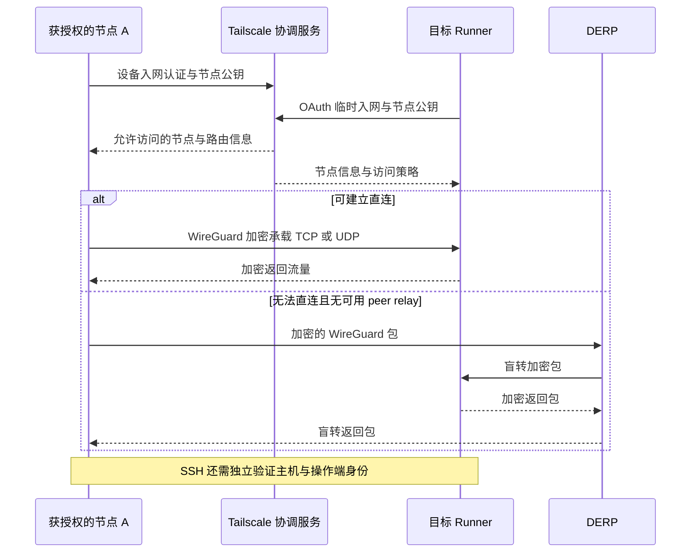
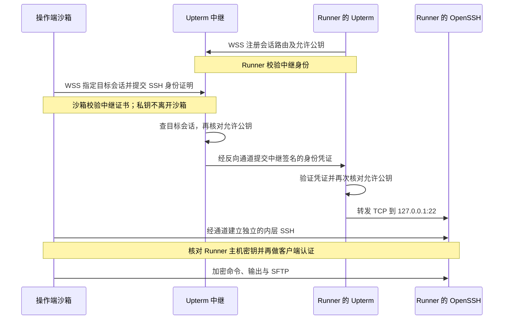
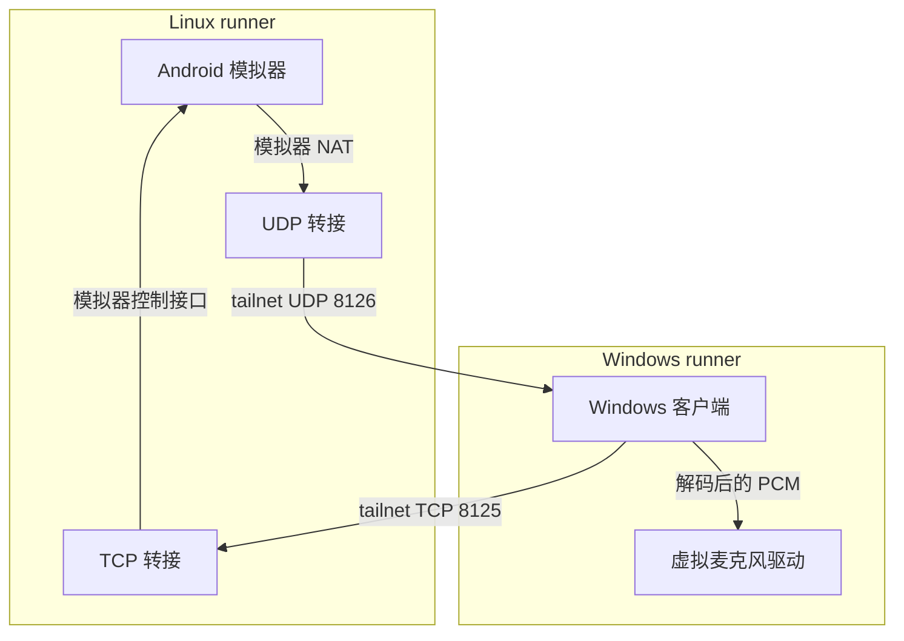

# 构建、验证与实验环境

日常提交使用 **CI**；需要一台可操作的机器、安装后的真实现场或双机联调，使用 **Lab**。两个入口调用同一套构建和验证组件。Lab 只由网页或 API 的 `workflow_dispatch` 启动，push 不会打开 SSH。

## 选择入口

| 目的 | 入口与选择 | 结果 |
|---|---|---|
| 自动检查提交 | CI：push 到 main／指向 main 的 PR | 按改动选择平台，执行相关验证 |
| 只编译 | CI：`task=build`，选择 `target` | 公开构建包、原始许可、来源及校验清单 |
| 强制复核两端 | CI：`task=verify,target=both` | Android、Windows 各自的验证结果 |
| 干净 Windows／Linux 环境 | Lab：`scenario=base,target=windows/linux` | 仅为接入配置网络及 SSH，不装本项目 |
| 工具链环境 | Lab：`scenario=toolchain` | 准备工具后开放操作窗口 |
| 成品已下载但未安装 | Lab：`scenario=built,target=windows/android` | 可检查或手动安装构建产物 |
| 安装后交给人操作 | Lab：`scenario=installed` | 同一机器安装并检查就绪，再开放 SSH |
| 在测试阶段暂停或故障留场 | Lab：`scenario=verify` | 复用 CI 验证，在选定位置交接现场 |
| 真实音频链路／两端现场 | Lab：`scenario=dual` | Android 模拟器与 Windows 客户端同时在线 |

“干净”指没有安装本项目和额外工具链的 GitHub 托管镜像；镜像已有预装软件，接入本身需要 Tailscale 和 OpenSSH。`android` 的运行环境是 Ubuntu 上的模拟器，不是实际手机。SSH 提供命令行，不等于 Windows 图形桌面或已登录的交互会话。

## 从网页运行

1. 打开仓库 **Actions**，选择 **CI** 或 **Lab**，点击 **Run workflow**。
2. 选择分支，填写下表的参数。新工作流需要先存在于默认分支，GitHub 才显示手动入口。
3. 查看运行的 **Summary**：先显示执行计划；Lab 就绪后显示连接信息，并生成 `connection-…` 附件。
4. 默认选择 **Tailscale Tailnet**；无法入网的操作端可选择 **Upterm Relay**。这里是 Tailnet（虚拟私网），不是 Telnet 协议。两种方式均使用对应 SSH 私钥。连接附件含本次主机公钥，先核对主机身份；不要全局关闭主机密钥检查。
5. 使用下文工具执行或结束；SSH 断开可以重连，断开本身不会结束 Lab。到期则收证并继续后续步骤；通过记录工具仍在执行的命令会终止进程树，超时返回 124，显式结束返回 130。自行后台化的进程由操作者负责收尾。

## 参数

CI 的 `task` 为 `verify`（默认）或 `build`；`target` 为 `auto`（默认）、`android`、`windows`、`both`。`auto` 在 push／PR 中按改动选择，手动运行时验证两端。CI 始终产生稳定的 `CI result`，未涉及的平台可以跳过；被选中任务因依赖失败而跳过不算通过。CI 不等待人工接入。

| Lab 参数 | 默认 | 用法 |
|---|---|---|
| `scenario` | `base` | `base/toolchain/built/installed/verify/dual`，见上表 |
| `target` | `windows` | `windows/android/linux/both`；`linux` 仅基础与工具场景，`dual` 自动选择两端 |
| `android_variant` | `release` | installed/verify 场景选择 release 或 debug；不影响同时构建两者 |
| `artifact_run_id` | `0`（文本） | 0 表示本次构建；指定运行编号可复用符合新清单格式的构建包 |
| `pause_at` | `ready` | 单端 verify 的 ready 对应测试开始前；还支持下述暂停点 |
| `session_minutes` | `20` | 环境就绪后的操作时长，整数 1–120 分钟；准备阶段另计 |
| `ssh_transport` | `Tailscale Tailnet` | 网页选择 `Tailscale Tailnet` 或 `Upterm Relay`；后者显式启动 WSS 中继，操作端无需入网；双机媒体仍走 tailnet |
| `stream_logs` | **不勾选** | 开启后，记录工具执行的命令和输出经过脱敏后进入公开 Actions 日志和转录附件 |
| `request_id` | 空 | Agent 的关联编号；命令行启动工具自动生成 |

Windows verify 支持 `before-install`（装驱动前）、`before-permissions`（权限矩阵前）、`after-permissions`（矩阵后）、`after-test`、`on-failure`、`none`。Android verify 支持 `ready`、`before-install`、`after-test`、`on-failure`、`none`。安装场景在安装就绪后仅交付一次，不额外执行整套验证。基础、工具、成品和安装场景只接受 `pause_at=ready/none`；测试阶段暂停只用于 verify／dual。

双机支持 `ready/after-test/on-failure/none`。ready 场景在双方就绪后协调共同截止时间，双方会话收尾后再继续自动验证；故障留场分别保留出错一端的现场。双机失败后重跑整组，不能拿旧轮次的一端与新轮次的另一端配对。

不适用的组合由 plan 作业立即拒绝，避免先占用 Windows 或启动构建后才报错。

## 从 Agent／终端运行

先通过凭据管理器设置 `GH_TOKEN`，需要 Actions 读写权限；不把 token 作为命令参数。工具默认从 Git origin 推导仓库，也可设置 `GH_REPO=owner/repo`。启动工具固定使用 GitHub REST API `2026-03-10`，直接返回本次运行编号；响应不确定时按 `request_id` 核对，不能盲目重复提交。REST 请求中的输入值按字符串提交；工作流 plan 再校验并转换数字，运行编号按文本传输。

```bash
# 只编译 Windows
python .github/scripts/labctl.py dispatch ci.yml --ref main \
  --input task=build --input target=windows

# 安装后交接 Windows，SSH 正文保持私下返回
python .github/scripts/labctl.py dispatch lab.yml --ref main \
  --input scenario=installed --input target=windows --input session_minutes=20

# 在已有构建基础上双机自动联调，不暂停、不重复编译
python .github/scripts/labctl.py dispatch lab.yml --ref main \
  --input scenario=dual --input artifact_run_id=RUN_ID --input pause_at=none

# 沙箱不能加入 tailnet：通过 Upterm 接入 Windows 的原生 SSH
python .github/scripts/labctl.py dispatch lab.yml --ref main \
  --input scenario=base --input target=windows --input 'ssh_transport=Upterm Relay'

# Agent 明确选择将记录工具的操作公开
python .github/scripts/labctl.py dispatch lab.yml --ref main \
  --input scenario=base --input target=windows --input stream_logs=true
```

将返回的实际运行编号代入后续命令。示例中的 `RUN_ID` 是占位符。

```bash
# GitHub 作业／步骤状态，不需要先连入 tailnet
python .github/scripts/labctl.py status --run RUN_ID
python .github/scripts/labctl.py watch --run RUN_ID --timeout 60

# 等连接附件出现，取得本次地址、主机公钥及运行时路径
python .github/scripts/labctl.py connection --run RUN_ID --role windows --output lab-connection.json

# 自己的电脑须先接入获授权的 tailnet；私钥只在操作端使用
python .github/scripts/labctl.py exec --connection-file lab-connection.json \
  --identity /path/to/private-key -- python -c "print('hello')"

# 主动结束当前角色的操作窗口，流程随即收证并继续
python .github/scripts/labctl.py finish --connection-file lab-connection.json \
  --identity /path/to/private-key
```

连接信息只需获取一次；`--connection-file` 让后续命令直接走 SSH，不为每条命令重新查询 GitHub。元数据仍有截止时间，重跑后必须重新获取，不能复用上轮主机身份。

如果使用 **Upterm Relay**，操作端先从 [Upterm 官方发行页](https://github.com/owenthereal/upterm/releases/tag/v0.40.0) 安装 0.40.0 并加入 PATH，按同页校验清单核对下载；runner 自动取得固定版本并验证 SHA256。`upterm proxy` 只传输 WSS 字节流，外层 SSH 转发至 runner 的 `127.0.0.1:22`，内层仍是原生 OpenSSH。公钥限制同时用于中继和本机 SSH；CLI 固定官方中继 CA，并独立核对本次 runner 主机公钥。该方式不要求本地 TUN、netlink 或常驻服务。中继地址会公开，不能以地址保密代替公钥认证；仅在显式选择时启动，窗口结束立即停止。

直接 REST API 的 `inputs.ssh_transport` 使用网页中的完整名称。`labctl dispatch` 兼容旧简写 `tailnet/relay`，发送前转换；组件及 `labctl exec --transport` 仍使用内部简写，通常由连接缓存自动选择，无需手填。

也可导出相同信任配置给原生 SSH 和 SFTP，私钥只引用本地路径，不复制进配置：

```bash
python .github/scripts/labctl.py ssh-config --connection-file lab-connection.json \
  --identity /path/to/private-key --output lab-ssh.conf
ssh -F lab-ssh.conf miclink-lab
sftp -F lab-ssh.conf miclink-lab
```

直接 shell 的工作目录及环境是 SSH 默认值；`labctl exec` 则恢复本项目准备阶段的工具上下文。连接元数据、配置及主机公钥是本次临时接入文件，不提交进仓库。文件传输由操作者自行选择文件，不触发 Actions artifact 上传。

角色名：单端 `windows/android/linux`；双机 `windows-client/linux-app`。双机操作完成后分别结束两端。`watch` 的观察期限届满返回 75，表示运行仍在继续，不会自动取消。客户端工具可从任意目录通过完整脚本路径调用；已有 userspace Tailscale 客户端可用 `TAILSCALE_SOCKET` 配置 ProxyCommand。

CLI 从连接附件生成本次专用 known_hosts，并严格检查主机公钥。传给远端的路径均来自运行时元数据。记录工具恢复已准备现场的工作目录和 PATH／SDK 等明确允许的变量，不复制 job 的 token、OAuth secret 或整个环境。

## 两种 SSH 接入与媒体网络

`ssh_transport` 只选择**操作者如何进入 runner**，不选择两台 runner 之间如何传音频。无论选哪一项，当前 Lab 都会给 runner 建立 tailnet；双机音频的 TCP 控制与 UDP 媒体继续走 tailnet。

| 能力 | Tailscale Tailnet | Upterm Relay |
|---|---|---|
| 操作端前提 | 已加入获授权的 tailnet，可访问 runner TCP 22 | OpenSSH、固定版本 Upterm、可出站访问 WSS 443 |
| 定位目标 | 本轮连接附件中的 tailnet IP 与 SSH 用户 | 同一附件中的 Upterm 会话路由标识，再转发本机 TCP 22 |
| 身份验证 | tailnet 准入/访问策略，再做普通 OpenSSH 认证 | 中继身份校验、会话允许公钥检查，再做独立内层 OpenSSH 认证 |
| SSH 与 SFTP | 支持 | 支持，使用本项目的内层 OpenSSH |
| 原生 UDP/虚拟 IP 网络 | tailnet 可承载 TCP 与 UDP | 当前 Upterm 方案仅转发 TCP，没有 UDP 隧道或虚拟网卡 |
| 双机音频 | 由 runner 的 tailnet 通道完成 | 仍由 runner 的 tailnet 通道完成；不经过 Upterm |

### Tailscale Tailnet：先入网，再访问指定节点

runner 通过 OAuth 以 `tag:ci` 临时节点身份入网；操作者使用自己获授权的节点。协调服务分发节点公钥、地址和访问策略，节点之间承载实际数据。应用发出的 TCP/UDP 封装在 WireGuard 网络中，能直连就直连；无法直连时可经 peer relay 或 DERP 传递加密包。DERP 不解密应用流量，应用仍使用自己的 TCP/UDP 接口。[Tailscale 连接类型](https://tailscale.com/docs/reference/connection-types)说明了这些回退路径。



图中 A 可代表操作者节点，也可代表双机联调中的另一台 runner。本项目在 tailnet 内使用**普通 OpenSSH**，没有启用 Tailscale SSH 产品；tailnet 准入不能替代 SSH 私钥认证。

### Upterm Relay：会话标识负责找谁，公钥负责谁能进

不是根据相同公钥自动配对。runner 启动 Upterm 后，将**会话路由标识和允许的操作端公钥**注册到中继；同一把公钥可以被多个会话授权。操作者先通过指定 run/attempt/role 的 GitHub connection artifact 得到目标会话标识，客户端把它放在外层 SSH 的用户/路由字段中。中继据此找到具体会话，再检查该会话是否允许这把公钥。持有对应私钥的签名证明身份，不能只复制公开的公钥登录。



操作端公钥、中继 CA、runner 主机公钥用途各不相同。流程按固定客户端版本与[Upterm 对应源码](https://github.com/owenthereal/upterm/tree/v0.40.0)核对，未独立确认公共中继当前部署版本。内层 SSH 身份和命令加密由操作者与 runner 独立掌控。

本项目客户端固定请求 `127.0.0.1:22`；Upterm 服务端开启的 `--allow-local-tcp-forwarding` 没有额外目的端口白名单，不能称为“服务端强制仅允许 22”。[Upterm](https://upterm.dev/)提供的是 TCP 转发，不是 TURN，也没有在本方案中提供原生 UDP。另把 UDP 封装到 TCP/WSS 会引入重传阻塞等行为，不能替代真实 UDP 链路验收。

### 双机音频：SSH 通道与媒体通道分开



这里的 `udp-relay.py` 是 Linux runner 上处理模拟器 NAT 的小工具，与公共 **Upterm Relay** 无关。控制连接最终为双向 TCP；箭头表示发起方向。端口是当前 workflow 的默认值。

迁移前的双机测试数据仅保留在私人历史资料中，旧运行不作为当前仓库的可访问证据。本轮未重跑双机场景，也未配置交互 Lab / 双机所需的环境变量，不将它计为本次验收通过。当前本仓库的普通 Android / Windows CI 结果见[验证报告](../../docs/verification/windows-e2e-report.md)。

双机链路仍需单独验证 TCP 与 UDP，不能因 SSH 可连接便认定媒体可达。GitHub 两个托管 job 不应被假定处在可直连局域网；排查时应看节点发现、访问策略、防火墙与模拟器转接统计。

## 实时输出与隐私

- **关闭 `stream_logs`**：SSH 输出仅返回操作端，runner 不记录命令或正文，也不生成会话转录附件。环境准备、自动测试和状态心跳仍是公开的 Actions 日志。
- **开启 `stream_logs`**：通过 `labctl exec`／`lab_session.py exec` 执行的操作会记录命令编号、时间、脱敏输出及真实退出码；前台监督进程按序读取并显式刷新到 Actions。
- 普通 SSH shell 绕过记录工具的命令、图形操作，不承诺自动留痕。命令文本同样可能含秘密；内联脚本正文不公开。大段无换行输出可能被抑制，二进制应使用文件传输。
- 脱敏是补充保护，不证明任意内容都适合公开。输入私密内容前保持关闭；关闭不能撤回此前已经公开的日志。
- 实时显示以**等待步骤尚未结束时出现输出**为验收标准。结束后 cat 回日志只算事后记录。旧 `tail -f | sed` 管道有缓冲风险，参见下文历史原因。

## Artifact 的生产与上传

公开仓库的 artifact 按公开内容管理，包括 job 之间的中转包。先从允许清单复制、处理文本并生成 manifest，再上传；不会直接上传整个工作区或整个 `probe-results`。

| 附件 | 生产时机 | 内容 | 保留 |
|---|---|---|---|
| `build-平台-run-attempt` | 构建成功后立即上传，先于运行验证 | APK 或应用／空包安装器、源码 SHA、文件哈希、MIT／第三方许可 | 3 天 |
| `report-…` | 自动验证完成或失败后 | 指定测试结果、经过处理的日志、干净自动测试截图 | 7 天 |
| `readiness-run-attempt-role` | 仅双机 ready 暂停，正式连接附件之前 | 运行身份、就绪时间及会话分钟数，用于对齐截止时间 | 1 天 |
| `connection-run-attempt-role` | SSH 就绪后、等待操作前 | 地址、用户、主机公钥、截止时间、动态路径，无私钥或入网密钥 | 1 天 |
| `session-run-attempt-role` | 操作结束后 | 结构化会话状态；仅开关开启时含处理后的转录 | 7 天 |

构建包有 manifest 与 SHA256SUMS，下载后先核验来源及哈希。Lab 指定旧运行时明确显示它的来源 SHA；不会偷偷使用其他运行的“最新产物”。附件保留期不是正式 Release 保留策略，需要长期保存的产品应另行发布。

不上传：官方驱动 SYS／INF／CAT、官方安装包、内嵌驱动的测试 EXE、任何凭据或 SSH 私钥、SQLite 原始会话库、全量环境转储、人工桌面截图、真实麦克风录音，以及任意未明确挑选的人工文件。Lab 默认只上传结构化验证摘要，不自动导出个人操作生成的文件。

Windows 构建强制 `pack_driver.py --empty`，并检查资源和 EXE 中是否存在非空驱动包。真实驱动由验证 runner 现场获取并核对官方安装包及三架构 9 文件的哈希；原生 C 解压 9/9、外部目录复制 18/18 自检和驱动安装仍执行，但这些测试材料不经公开 artifact 中转。客户端通过显式外部驱动目录安装。Opus 产物附带实际取得版本的原始 COPYING。

失败时仍尽力收集允许公开的证据；硬取消或 runner 丢失时不能保证最后上传成功。旧工作流已经上传的历史附件不会因为本次改配置自动消失。

## 时间、重跑与结果

基础场景不构建；需要成品时每个平台只构建一次；已有合格产物可复用。自动 CI 的新提交可取消旧验证，手动 CI 不互相打断。Lab 使用独立队列，不被 push 取消；使用 GitHub `queue: max` 逐个启动，最多 100 个等待请求，排队不占用操作窗口。

进程、步骤和 job 分层设置硬预算；会话时长从就绪开始，双机就绪暂停使用共同截止时间。状态明确区分 PREPARING、READY、WAITING、RELEASED、EXPIRED、CANCELLED。会话到期不是产品测试通过；测试结果保留 PASS／FAIL／UNSUPPORTED／未执行。标准用户交互会话录音 G2 仍按现有结果报告，不因 SSH 能登录而改为通过。

安装、验证和暂停在同一 job 中连续执行。`needs` 只安排作业依赖，不把安装状态传给另一台机器。双机两端并行，发现对端时精确匹配运行编号、重试轮次和在线状态。

## 为什么保留这些实现

| 约束 | 原因与迁移位置 |
|---|---|
| 普通 SSH＋Tailscale／可选 WSS | 历史 Upterm 直接共享 PTY 给 Agent 增加适配成本；默认使用 tailnet 普通 SSH。当前沙箱 netlink 与 Unix socket 均受限，tsnet 也无法启动，因此可显式用 Upterm WSS 转发原生 SSH，保留普通命令退出码及 SFTP |
| 入网与 SSH 分开 | 双机现场已入网，再次 up 会改变节点状态；`lab-session` 只配置 SSH 和会话 |
| 原阶段暂停 | 交付的是安装、权限矩阵执行到指定位置的真实现场，保留旧四个 Windows 插点语义 |
| 前台监督与显式 flush | 历史运行 39642016060 的 308 行转录只在结束后出现；后台 tail 加普通 sed 不算流式验证 |
| `adb exec-out` 与 `read1` | C05 曾由 PTY 的 ONLCR 改写二进制、以及读取缓冲语义引起；已有协议回归继续保留 |
| apt 镜像和进程硬超时 | 曾出现工具链安装、adb 等待和诊断挂起；保留已验证的镜像处理与有限重试 |
| `pwsh`、UTF-8、管道退出码 | 旧编码及 tee 返回码曾掩盖真正失败；不以“日志有成功文字”代替退出码和系统状态 |
| 原生驱动解压、安装状态、录音与 GUI | 各自验证不同层次，不能互相替代；SYSTEM／标准用户会话矩阵继续保留 |

逐步骤旧位置、新脚本阶段和预算见[迁移对照](../actions/migration-map.json)。公共组件见 [Actions 模块说明](../actions/README.md)，通用工具见 [脚本说明](../scripts/README.md)。本仓库本轮 [CI 40735612451](https://github.com/1-1-2/MicOpen/actions/runs/40735612451) 的 Android / Windows 构建与运行验证均通过；交互 Lab、WSS 接入和双机音频场景未在本轮重跑。G2 仍为 `UNSUPPORTED`，不计作通过。
