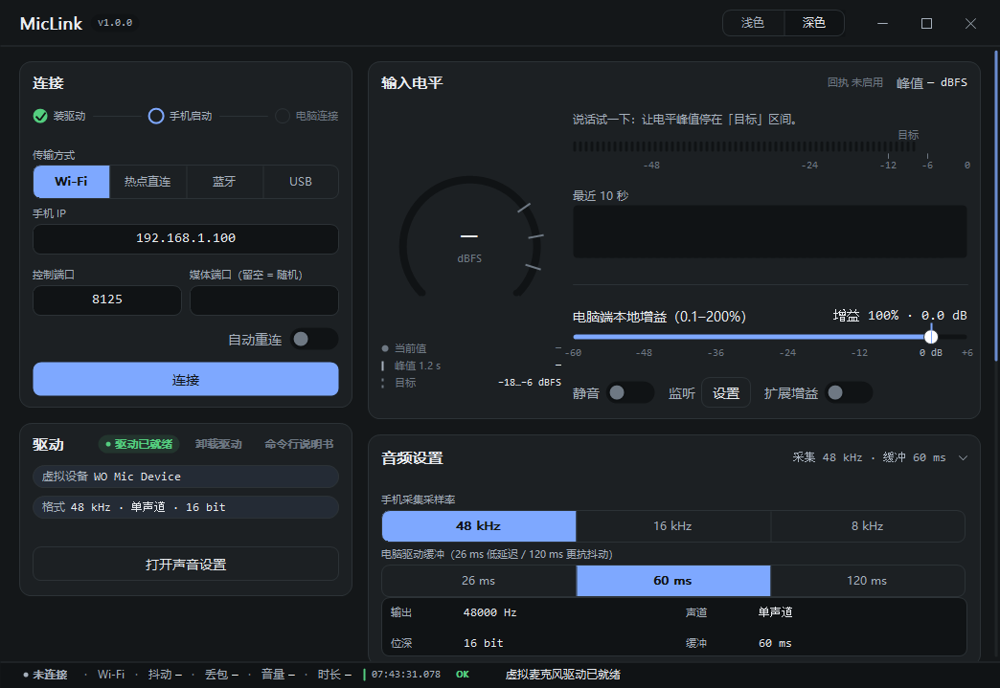
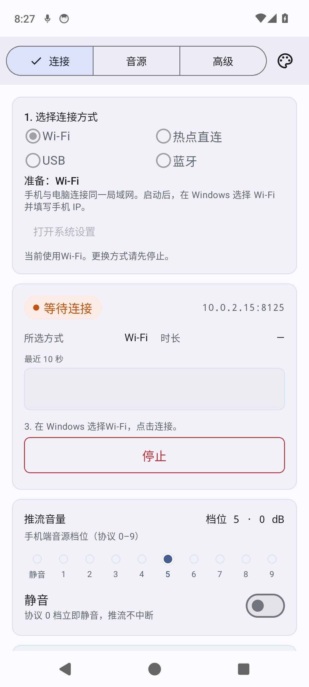
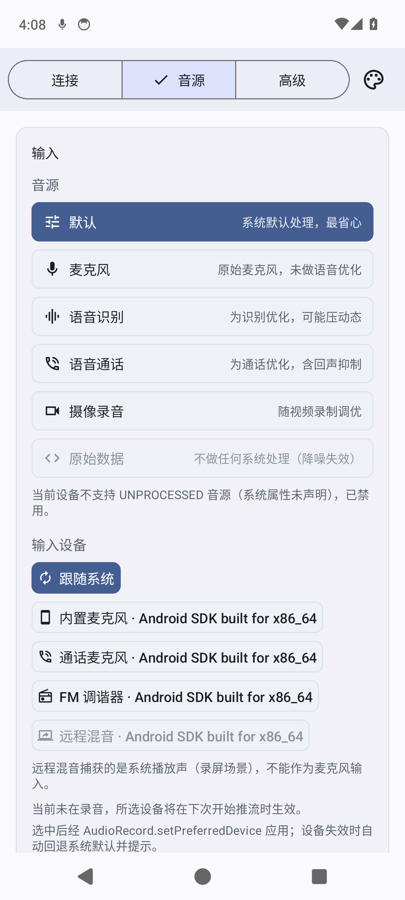
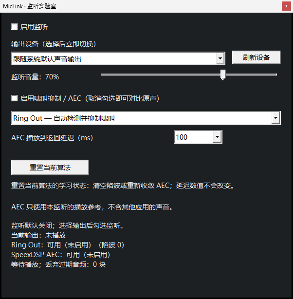

<div align="center">

# 🎙️ MicLink Open

**让你的 Android 手机成为 Windows 电脑上更好用的麦克风。**

手机收音，电脑开麦。连接有选择，声音有分寸。

**简体中文** · [English](README.en.md)

[获取软件](#download) · [自行构建](#build) · [快速上手](#quick-start) · [文档地图](#docs)

</div>

MicLink Open 基于成熟的 **WO Mic 虚拟麦克风驱动**，重新构建 Android 采集端与 Windows 接收端。我们把心思放在每天会碰到的细节上：怎么连、怎么调、怎么听，以及出了问题怎么看得明白。

这是独立维护的客户端项目，与 WO Mic 官方无隶属关系，不代表官方合作或认可。感谢 WO Mic 提供成熟的虚拟音频驱动基础；驱动仍由其提供方维护并按其自身条款授权。

## 一部手机，随你接法

📶 **Wi-Fi（路由器 / 手机热点）** · 📡 **无线直连** · 🔵 **蓝牙** · 🔌 **USB**

> 开发版已合并 Wi-Fi 与热点入口，并新增真正的 **Wi-Fi Direct**。无线直连等待用户实机验收，暂不发布；下方正式下载仍为 v0.1.2。



<sub>截图为 v0.1.2 正式版；开发版的连接选项已调整。</sub>

| 连接方式 | 怎么接 |
|---|---|
| 📶 Wi-Fi | 手机与电脑连接同一路由器，或让电脑加入手机热点，再填写手机 IP。 |
| 📡 无线直连 · 待实测 | 本实验分支由电脑等待，手机搜索并选择电脑，再在电脑允许连接；不用填 IP 或开启热点。 |
| 🔵 蓝牙 | 先在系统中配对，再从 Windows 客户端选择已配对手机。 |
| 🔌 USB | 数据线连接，开启 USB 调试并授权电脑；需要外置 ADB。 |

**普通连接：手机选方式并启动 → 电脑连接。无线直连实验：电脑先等待 → 手机搜索并选择电脑。** 更换方式前，先在手机停止服务。Wi-Fi 包含路由器和手机热点；无线直连使用独立的 Wi-Fi Direct 组。

### 🎚️ 收什么音，怎么收，你来定

Android 把「连接」「音源」「高级」分开摆好，常用操作伸手可及：

- **选音源、选设备**：麦克风、语音识别、语音通话、摄像录音等音源，以及系统提供的输入设备；支持时可选原始音源。
- **调音量、看电平**：推流音量与实时电平同屏，采集状态有迹可循。
- **按需打开系统效果**：降噪、回声消除、自动增益；不可用的效果会提示，不装作已经生效。

<p align="center">
  <a href="site/assets/android-connect-test.png"></a>
  <a href="site/assets/android-source-test.png"></a>
</p>

<p align="center"><sub>截图来自 Windows CI 与 Android 模拟器；地址、设备名为测试数据。点击图片可查看大图。</sub></p>

系统音效取决于手机硬件、ROM 和所选音源。Android AEC 没有电脑扬声器的播放参考，不能等同于整条链路的回声消除；切换采集设置也可能短暂中断声音。

### 🎧 先听见，再调顺

Windows 端提供输入增益、扩展增益和一键静音。打开「监听实验室」，可以选择播放设备、单独调整监听音量，边听边调。

可选监听模块包含 **Ring Out 自动啸叫检测与陷波抑制**，以及 **SpeexDSP AEC 实验模式**。两者处理的是本地监听副本，**不会把处理后的声音写回虚拟麦克风**。监听和处理默认关闭；效果需要结合实际设备与房间试听。

<details>
<summary>打开监听实验室，看一眼可调项</summary>



模块安装、延迟调整与效果边界见[监听说明](client/monitor/README.md)。优先用耳机试听，再评估扬声器场景。

</details>

### 🧭 连得明白，也看得明白

| 日常操作 | 随时可看的细节 |
|---|---|
| 连接与恢复 | 驱动就绪提示、按连接方式切换的地址输入、可选自动重连。 |
| 音频与状态 | 输入电平、峰值、采样率与缓冲设置；会话时长、抖动和丢包统计。 |
| 排查与复现 | Windows 运行事件可复制；Android 440 Hz 调试音可帮助检查链路。开发分支另有 Android 日志节选／全部复制，见[直连测试说明](docs/WIFI-DIRECT.md)。 |
| 外观与习惯 | Windows 浅色／深色；Android 跟随系统、预设配色、Android 12+ 动态取色与 AMOLED 纯黑。 |

Wi-Fi、手机热点、蓝牙和有线 ADB / USB 均已有用户实机可用反馈。[本仓库 CI](https://github.com/1-1-2/MicOpen/actions/runs/40735612451)已通过两种 Android 构建、模拟器 ADB 转发、Windows 协议／驱动及 ADB 退出清理检查；这些不代表所有设备和长时间场景都已验证。详见[发布记录与验证范围](docs/RELEASES.md)。

> [!IMPORTANT]
> **关于 Windows 的安全提示**
>
> MicLink Open 是公开源代码的独立项目。Windows 客户端可能因缺乏代码签名或应用信誉，触发 SmartScreen 的「Windows 已保护你的电脑」提示。这类信誉提示不等于已确认存在恶意软件，开源本身也不是安全保证。请核对下载来源与发布校验文件，按需审查源码或自行编译；本项目不要求关闭 Windows 安全防护。[了解 Microsoft 的应用信誉说明](https://learn.microsoft.com/en-us/windows/apps/package-and-deploy/smartscreen-reputation)。

<a id="download"></a>

## 📦 获取软件

**[前往 MicOpen Releases →](https://github.com/1-1-2/MicOpen/releases)**

源码、问题反馈与正式发布统一在 [`1-1-2/MicOpen`](https://github.com/1-1-2/MicOpen)。`v0.1.2` 提供独立安装包和两端合集，更新内容见[发布记录](docs/RELEASES.md)。

- **Android APK**：`MicOpen-Android-v0.1.2.apk`。安装后授予麦克风权限，按系统提示允许前台服务通知。
- **Windows x64 ZIP**：`MicOpen-Windows-x64-v0.1.2.zip`。完整解压，运行 `womic.exe`；保留同目录的监听 DLL、安装器与许可文件。
- **安卓／Windows 合集**：`MicOpen-v0.1.2-Android-Windows.zip`，一次下载两端及对应许可、源码材料。
- **校验清单**：`SHA256SUMS.txt`。核对下载文件的 SHA-256；一致只说明文件与清单一致，不是安全认证。

**先准备好这些：**

- **Android 8.0+**。系统音效和输入设备的可用性以手机实际显示为准。
- **Windows x64 与兼容的 WO Mic 驱动**。请从 [WO Mic 官方渠道](https://wolicheng.com/womic/)获取驱动；本项目验证基线是 2022 版 `2.1.0.0`，不承诺任意新旧版本、x86 或 ARM64 已通过验证。见[驱动说明](docs/protocol/driver-whitepaper.md)。
- **USB 才需要 ADB**。从 [Google Platform-Tools](https://developer.android.com/tools/releases/platform-tools) 获取 Windows 版本，保留完整工具目录并加入 `PATH`；也可将 `adb.exe` 与配套 DLL 放到 `womic.exe` 同目录。客户端不会自动下载 ADB，也不会搜索任意子目录。完成 USB 调试授权后，它会创建和清理自己的端口转发。详见[连接指南](docs/TRANSPORTS.md#operation)。

想自行编译，可按下一节构建。[GitHub Actions](https://github.com/1-1-2/MicOpen/actions/workflows/ci.yml) 也提供短期测试产物：**CI 的 release 是测试签名，不是正式分发签名**；源码归档不含第三方驱动，公开 CI 安装器也不内置驱动。

<a id="build"></a>

## 🛠️ 自己动手构建

Android 使用 Kotlin / Compose，Windows 使用原生 C / C++。可以只构建其中一端；Linux 在这里是构建环境，**没有 Linux 桌面接收端**。

### Android · Windows 或 Linux

准备完整 **JDK 17**、Android SDK `37.0`、NDK 和 CMake `3.22.1`。SDK 安装、签名变量与版本明细见[构建说明](docs/BUILD.md)。从当前源码检出的仓库根目录执行（Windows 的源码准备步骤使用 Git Bash）：

```bash
bash .github/scripts/fetch-opus.sh
cd android
./gradlew :core:test :app:testDebugUnitTest \
  :app:assembleDebug :app:assembleRelease
```

Windows 的 CMD / PowerShell 在准备好 Opus 后，进入 `android`，用 `gradlew.bat` / `.\gradlew.bat` 执行同样的任务。产物位于 `android/app/build/outputs/apk/`。release 开启 R8 和资源裁剪；**未配置发布密钥时生成未签名 APK，不能直接安装**。开发调试可用 debug；分发请配置自己的固定签名身份。

### Windows x64 客户端 · Linux 交叉编译

在 Ubuntu 24.04 或 Windows 的 WSL2 Ubuntu 中，准备 MinGW-w64 **GCC / G++ POSIX 工具链**、Python 3、7-Zip、curl 和 make，然后从仓库根目录执行：

```bash
bash client/tools/build_opus.sh
bash client/build.sh
bash client/monitor/build.sh
```

输出在 `client/build/`：主程序 `womic.exe`、驱动管理工具 `womic-drvinst.exe`，以及两个可选监听模块 DLL。第一步静态链接所需的 Opus 库由脚本准备；第三步构建 Ring Out / SpeexDSP 模块并附许可与对应源码。安装依赖的完整命令见[构建说明](docs/BUILD.md#windows)。

`client/build.bat` 尚未同步当前监听模块和开关控件的完整编译依赖，暂不作为当前客户端的可靠原生构建入口；Windows 开发者请使用上述 WSL2 路径。CI 验证的是 Linux 交叉构建与 Windows 原生运行。公开源码构建出的空包安装器不能直接安装驱动，日常使用请先安装官方驱动。

<a id="quick-start"></a>

## 🚀 用 Wi-Fi，先开一次麦

1. **连到同一张网。** 手机与电脑接入可互访的局域网，电脑已安装兼容驱动。
2. **手机先启动。** 打开 MicLink Open，选择「Wi-Fi」，点击「启动」，保持等待连接；记下页面显示的 IP 与控制端口。
3. **电脑再连接。** 打开 `womic.exe`，选择「Wi-Fi」，填写手机 IP 与相同控制端口（默认 `8125`），点击「连接」。
4. **到常用软件里开麦。** 在会议软件、录音机或 OBS 中选择 WO Mic 虚拟麦克风。说几句话，看电平，再调整音量。

连接不上？先看手机是否仍在等待、地址是否正确，再检查访客网络隔离与防火墙是否允许应用通信。已连接却无声？依次看接收统计、电平、所选录音设备。[Windows 排查](client/README.md#排查) · [其他三种连接方式](docs/TRANSPORTS.md#operation)

<a id="docs"></a>

## 🗺️ 按你想做的事，找文档

| 我想…… | 从这里开始 |
|---|---|
| 换一种连接方式 | [连接指南与验证范围](docs/TRANSPORTS.md)（英文），含 ADB、蓝牙和热点。 |
| 调整采集或监听 | [Android 采集端](android/README.md) · [Windows 接收端](client/README.md) · [监听实验室](client/monitor/README.md)。 |
| 从零搭建开发环境 | [逐步构建与联调](docs/STEP-BY-STEP.md) · [工具链与签名](docs/BUILD.md)。 |
| 看懂声音如何到达电脑 | [通信协议](docs/protocol/womic-wifi-protocol-v1.md) · [驱动接口白皮书](docs/protocol/driver-whitepaper.md)。 |
| 了解测过什么、还差什么 | [当前交付与已知问题](docs/CLOSEOUT-2026-10-28.md) · [Windows 验证](docs/verification/windows-e2e-report.md) · [人工互操作清单](docs/verification/android-interop-checklist.md)。 |
| 复现测试或接入 CI 现场 | [CI / Lab 操作](.github/workflows/README.md) · [Android 验证](android/verify/README.md)。 |

更完整的维护、脚本与贡献入口见[工程文档地图](docs/README.md)。反馈问题时，附上两端版本、连接方式、设备／系统版本与相关日志即可；请去掉个人信息和凭据。

## 🤝 致谢与许可

感谢 **WO Mic / Wolicheng Tech** 的虚拟麦克风驱动，感谢 **Xiph.Org Opus、SpeexDSP** 的音频编解码与处理工作，以及 **Dusk Audio Ring Out** 的啸叫检测与陷波核心。

MicLink Open 自有代码以 [MIT](LICENSE) 授权；第三方代码保留各自许可。**包含 Ring Out 的监听测试组合按 GPL-3.0-or-later 分发**，对应源码与许可要求见[组合许可](client/monitor/TEST-LICENSE.md)。WO Mic 驱动是独立的第三方软件，不受本项目 MIT 许可覆盖；构建工具支持使用自备驱动，不代表获得再分发授权。

完整来源与授权边界见 [NOTICE](NOTICE.md)。本项目两端的互通验证不等同于与 WO Mic 官方客户端互操作通过；USB / 蓝牙使用 MicLink 自有流式扩展，请配套使用本项目两端。

<div align="center">

**把连接交给软件，把声音留给你。**

</div>
