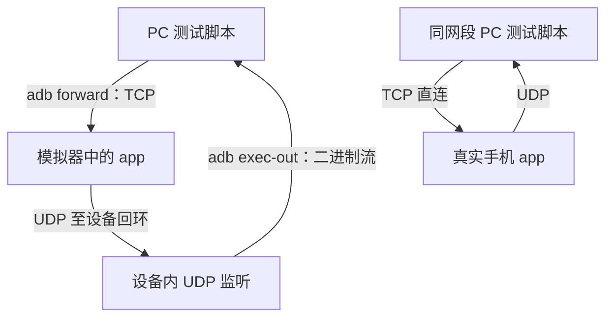

# Android 协议闭环联调

`pc_client.py` 用 Python 标准库实现测试用接收端，与已启动的 Android app 建立真实会话。`test_pc_client.py` 检查监听就绪、重启、进程退出和二进制回传等工具行为。字段定义见[通信接口说明](../../../docs/protocol/womic-wifi-protocol-v1.md)。

## 执行

在仓库根目录运行离线验证：

```bash
python3 android/verify/integration/pc_client.py --self-test
python3 android/verify/integration/test_pc_client.py
```

连接模拟器前先安装 APK、启动服务，可启用调试音；然后运行：

```bash
python3 android/verify/integration/pc_client.py --hold-seconds 12
```

直接连接同网段手机时，使用 `--control-host` 指定手机地址，`--control-port` 指定 app 显示的端口，并选择 `--udp-tap host`。完整参数通过 `--help` 查看。CI 入口为 `.github/workflows/ci.yml` 的 `verify-android` 作业。

## 两种拓扑



默认 adb forward 模式下，app 看到的 TCP 对端是设备侧回环地址；测试工具需要从设备内回收 UDP。直连模式中媒体直接发送到主机的接收端口。两种方式不能混用监听位置。

## 断言与排查

C01–C15 覆盖连接、HELLO、参数、启动、首包格式、音量、序号、时间戳、包速率、心跳、看门狗、停止和完整重连。退出码 0 表示通过，1 表示断言失败，2 表示环境错误。

- 首包失败时先确认 UDP 监听已 bind 且进程仍存活，再检查 app 是否发包。
- 设备内监听重连时需要重建，避免旧 UDP 对端限制导致新会话的包被丢弃。
- 二进制数据使用 `adb exec-out`。带 PTY 的通道可能进行 ONLCR 转换，破坏 Opus 数据；文本诊断仍可使用 shell。
- 工具会按配置重试监听并保留诊断；重试成功不应被描述为产品代码修复。

当前回归记录见[验证报告](../../../docs/verification/windows-e2e-report.md)。
