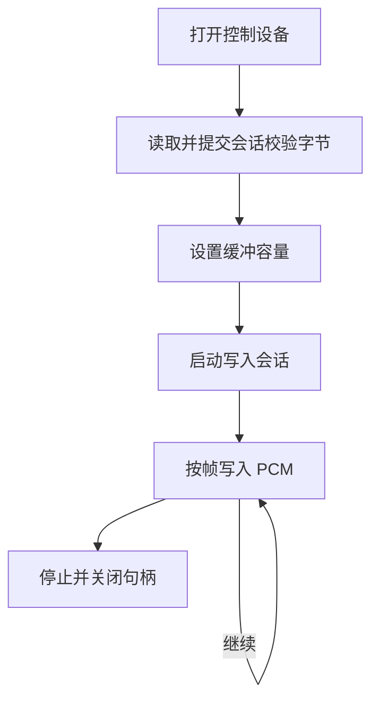

# Windows 驱动接口白皮书

本项目 Windows 接收端把解码后的 PCM 写入电脑上已安装的 WO Mic 虚拟麦克风驱动。本文记录当前代码采用的接口、验证基线与使用限制，供构建和排查时对照；它不是第三方提供的官方接口规范。

## 已验证基线

| 项目 | 当前验证范围 |
|---|---|
| 驱动 | 2022 基线，版本 2.1.0.0，硬件 ID `Root\WOMic` |
| 实际运行 | Windows x64 CI runner |
| PCM | 48000 Hz、16 位、单声道 |
| 帧长 | 20 ms，每帧 1920 B |
| 控制设备 | `\\.\WOMic` |
| 提供方标识 | Wolicheng Tech，官网 <https://wolicheng.com/womic/> |

打包工具可以核对三架构配套文件；这不等同于已经在 ARM64、x86 机器完成运行验证。2017 版驱动与当前接口不同，不应替换上述基线。

## 写入流程

调用实现位于 `client/src/devio.c`。打开设备后执行会话初始化，设置非零容量、启动，然后持续写入 PCM；结束时停止并关闭句柄。

| 操作 | 控制码 | 当前代码使用的数据 |
|---|---|---|
| 读取校验字节 | `0x222004` | 输出 1 字节 |
| 提交校验 | `0x222008` | 读取值异或 `0x3B`；输入与输出长度均为 1 |
| 设置容量 | `0x222014` | 2 字节大端，必须非零，上限 `0x2D00` |
| 启动/停止 | `0x222010` | 单字节 1/0 |
| 写入音频 | `0x222001` | 无包头的原始 PCM |

当前基线中，写入控制码可能返回 `FALSE` 与错误码 1，而音频仍被实际送入录音端点。因此代码不只依赖该返回值判定媒体效果，完整验证需要从 Windows 录音设备采集并检查能量和主频。驱动不会替应用修正采样率，应用必须提供基线要求的 PCM。

## 安装与定位

日常使用建议先通过官方渠道安装驱动，再运行本项目接收端。源码仓库不包含第三方 INF、SYS 或 CAT。外置驱动管理和构建选项见[客户端说明](../../client/README.md)。

安装器通过 Windows 系统接口定位 ProgramData，驱动状态检查通过系统目录定位 INF/SYS，不依赖固定盘符或某个用户目录。需要提权的安装操作由独立安装器执行。

## 已验证与限制

[2026-10-27 回归](../verification/windows-e2e-report.md)覆盖驱动安装、SYSTEM 和标准用户会话 0 录音、本项目两端真实推流与 440 Hz 音频检查。G2（标准用户交互会话录音）为 `UNSUPPORTED`，不计作通过。普通 Windows 桌面、不同驱动版本和其他硬件仍需各自验证。
