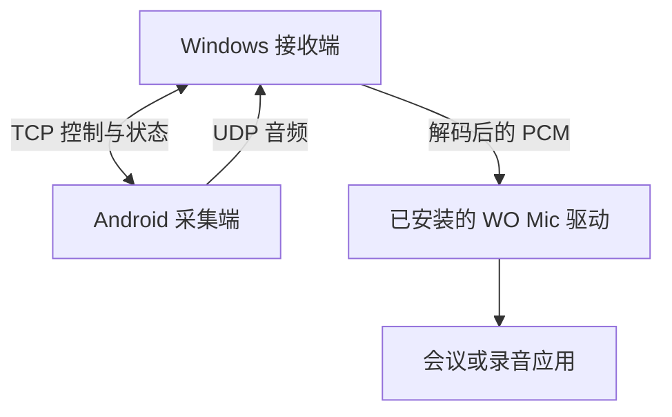
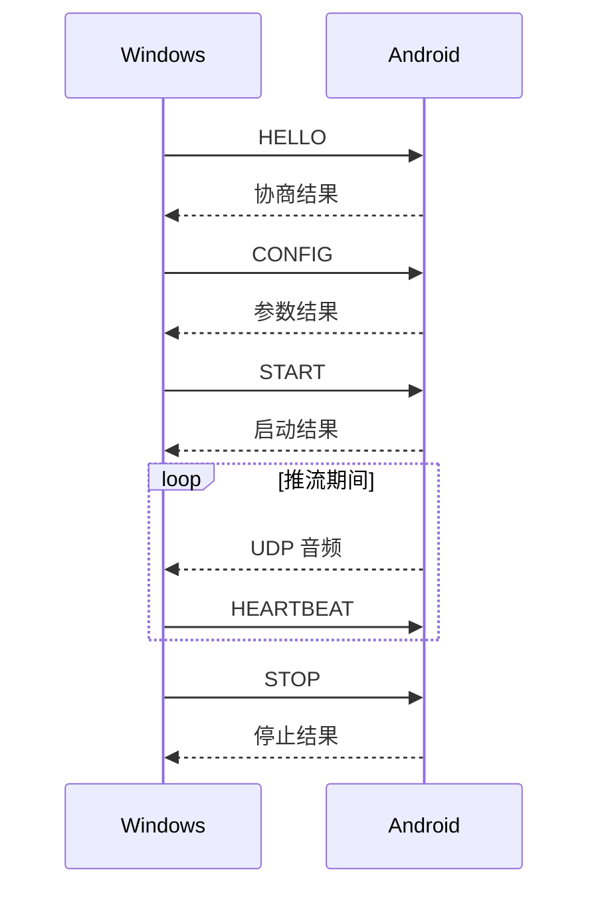

# 音频链路通信接口 v1

本文描述 MicLink Open 当前实现使用的通信约定，供维护采集端、接收端和测试工具时对照。实现入口为 `android/core` 和 `client/src/engine.c`，不代表第三方产品公开提供或承诺稳定的 API。

## 1. 连接模型

Android 端监听 TCP 控制连接；Windows 端发起连接，并在协商中提供接收音频的 UDP 端口。音频数据从 Android 单向发送到 Windows。

## 2. 控制帧

帧由 1 字节类型、4 字节大端负载长度及对应负载组成。流式读取须处理拆包和粘包。当前默认控制端口为 8125，可由用户配置。

| 类型 | 请求负载 | 行为 |
|---|---|---|
| 101 HELLO | 6 字节，当前默认 `04 06 03 00 00 00` | 协商媒体头格式 |
| 102 CONFIG | codec 1B、rateIdx 1B、媒体端口 4B 大端 | 配置编码、采样率和 PC 接收端口 |
| 103 START | 空 | 启动媒体发送 |
| 104 STOP | 空 | 停止媒体发送 |
| 105 HEARTBEAT | 空 | 更新会话存活状态，不单独应答 |

HELLO 应答为状态码与格式字节；CONFIG/START 应答负载为状态码。停止应答沿用 type 102 的兼容处理，测试工具据此验证停止结果。当前主要使用 Opus（codec 2）；采样率索引 0、1、2 分别对应 8000、16000、48000 Hz。错误状态 10 表示不支持的 HELLO 格式，12 表示编码不支持，13 表示采样率索引非法。

## 3. UDP 格式 C

当前客户端使用格式 C；包头长 11 字节，后接一帧 Opus 数据。多字节整数字段使用大端序。

| 偏移 | 字节数 | 字段 |
|---|---|---|
| 0 | 2 | 固定标记 `04 00` |
| 2 | 2 | 长度：Opus 负载长度加 7 |
| 4 | 2 | 序号，16 位自然回绕 |
| 6 | 4 | 采集侧单调时间戳，毫秒 |
| 10 | 1 | 音量档位，当前界面使用 0–9，5 为默认增益 |
| 11 | 可变 | Opus 负载 |

包的总字节数应等于长度字段加 4。接收端用序号统计跳号，并根据协议音量与本地输入增益调节 PCM。时间戳与帧间隔不等同于端到端延迟。

协议核心还包含格式 A/B 的包化支持，具体字节布局以 `UdpPacketizer.kt` 及对应测试为准；当前应用链路以格式 C 为主。

## 4. 生命周期与验证

当前帧长为 20 ms，客户端约每秒发送一次心跳，采集端默认 5 秒未收到心跳则结束会话。停止、异常和重连必须按会话归属释放 socket，避免旧连接清理逻辑影响新连接。

JVM 单测验证编解码与会话行为，`pc_client.py` 验证真实 app 的完整会话，双机工作流验证本项目两端的跨网音频。接口变更时应同步检查三层验证，运行方法见[联调说明](../../android/verify/integration/README.md)。
